# Schema Overview

The 2026 Radiance Mutuelle LUT By Night data-only enrichment attaches the three official downloadable GPX objects to the 10 km, 20 km and 30 km catalog formats, preserving their official distance/D+ labels and adding hashes plus parsed route metadata. The 10 km Rando remains without a GPX because its official page has no downloadable trace URL. No schema, grant, policy, visibility, or publication-state contract changes.

Bugs and feedback (`app_feedback`) now share the race-request review lifecycle; an admin reply is a `user_notifications` row linked by `feedback_id`, created atomically with the status by a service-role RPC. Runners hide a message with `deleted_at` instead of deleting it, so the admin keeps the reply and its read and deletion state.

Admin-to-runner messaging now uses owner-readable `user_notifications`. Race-request reviews atomically update `race_requests` and insert the mandatory in-app message; optional Resend and Expo delivery state stays server-managed. Authenticated clients receive explicit safe-column reads and `read_at`-only updates, while the review RPC remains service-role-only.

The 2026 SaintéLyon catalog snapshot uses the existing event, edition, format, aid-station and relay-point contracts: ten formats, 34 structured course aid stations, six relay handovers, and six official GPX objects shared across nine formats. SaintéGones deliberately has no GPX because no downloadable official trace exists. This data-only migration adds no schema, grant, policy, or publication-state change.

RaceBook publication is now a service-only versioned boundary. Organizer autosave continues to update the existing source tables and targeted triggers advance `racebook_publication_states.draft_revision`; public/mobile delivery resolves one immutable `racebook_publications` snapshot. The ten-version retention process preserves referenced assets and queues only unreferenced private Storage paths for asynchronous cleanup.

The mobile Courses card (`RaceEventSummaryCard`) now shows a brand-surface placeholder when an event has no usable image; `race_events.thumbnail_url` and format thumbnails keep their meaning and no column is added.

The September 14 security hardening makes Auth `app_metadata` the only database administrator source, protects profile role/trial/sign-in fields from client mutation, confines legacy user-created races to private standalone rows, restricts privileged analytics/trial/cron/maintenance functions to `service_role`, and makes `product_brand_review` obey caller RLS. The September 30 follow-up closes new runner race inserts entirely while preserving administrator and service-mediated organizer authoring.

RaceBook structured organizer content is normalized into `race_edition_services` (edition scope), `race_start_waves` and `race_awards` (format scope). Parent deletion cascades; clients read through RLS and mutate only through service-role replacement RPCs.

Their public RLS predicates traverse `races`, whose public visibility columns and client SELECT access already form the RaceBook boundary. They do not traverse service-role-only `race_event_editions`, which would make valid Data API reads fail with `42501`.

RaceBook visual identity is stored in the separate service-only `race_event_edition_branding` projection. Draft and published columns coexist on one edition-unique row; only the server exposes the published logo and colors through the existing sponsors payload. Pace Yourself's shared default pair is forest green `#2D5016` and alpine blue `#3F6F8F`; the accent migration updates only rows still carrying the complete former default pair.

Organizer ravito, station-product and relay replacements, organizer product creation plus attachment, and edition sponsor ordering use parent-locked service-only transactions. These functions add no client table access or new ownership model.

## Purpose

This document summarizes the Supabase Postgres schema as inferred from migrations and current code. Prefer `supabase/migrations/*.sql` over archived schema files when changing database behavior.

## Key Concepts

The November 2026 mobile plan-flow polish changes catalog search controls, image fallback presentation, same-day plan grouping, and existing-plan wording without adding a column, relation, query scope, or RLS path. A warning before planning a past event is derived from the already-loaded event date.

- Owner table: a table whose rows are tied to `auth.uid()`.
- Catalog race: a public or private row in `races`.
- Saved plan: a row in `race_plans` with flexible planner JSON.
- Plan share link: a public crew recap snapshot tied to a saved plan through a hashed token, with narrow crew-side tracking state.
- Plan aid station: per-plan aid station snapshot.
- Race aid station: catalog/private race aid station source, including water, solid, assistance service flags, and optional organizer detail JSON.
- Race relay point: ordered handover metadata, optionally linked to a source aid station but independent from nutrition planning.
- Organizer membership: event-scoped access through `race_event_organizers`.
- Organizer dashboard onboarding: a nullable completion timestamp on each organizer/event membership, independent from runner onboarding and edition-wide module setup.
- Event edition: canonical yearly date range in `race_event_editions`, shared by every format for that event year.
- Edition sponsor: an ordered loading/banner placement shared by every format in one edition, with only an aggregate raw-click counter.
- Race edition group: stable `races.edition_group_id` plus `races.series_name` pair used to group one format series across yearly editions.
- Race slug redirect: a reserved former course slug targeting the stable race id so canonical renames do not break indexed URLs.
- Event edition request: retired audit row from the former yearly-edition review workflow.
- Event publication request: retained legacy audit row from the former admin-approval workflow; current paid publication does not enqueue a request.
- Organizer format visibility: masked stores course/preview/RaceBook false; private stores course false, preview true, and RaceBook false; public stores all three true. Mobile removes masked rows from the application, exposes private rows to every runner for plan creation when the parent event/edition is visible, and gives only active organizers their dimmed functional RaceBook preview. Both the format-scoped and bulk service-only publication actions restore public state atomically under an active Essential, Complete or Signature entitlement. Format publication accepts an active event organizer or trusted app-metadata admin; its private boolean helper performs the Auth app-metadata lookup without granting `service_role` direct `auth.users` reads. Bulk publication selects complete public-source preview formats without requiring them to be live already. First publication stores durable provenance in `racebook_publication_approved_at` / `racebook_publication_approved_by`.
- Web course visibility: first public/mobile publication promotes `races.web_catalog_is_live`; later mobile private/masked or edition-hidden transitions preserve it so indexed factual pages remain stable. `is_public = false` clears it. Server-only explicit-column web reads use that branch without broadening client `races_select` or redirect policies.
- Organizer details: nullable JSONB on `race_events`, `races`, and `race_aid_stations` for progressive dashboard fields managed through organizer service routes.
- Normalized event geography: nullable city/department/region/country names and stable codes plus a paired anchor coordinate on `race_events`; all 96 current live events have a verified country, the 46 French events have full commune-level geography, and free-text format routes remain in `races.location_text`.
- Public event website coverage: `race_events.website_url` is the canonical narrow registration-link source for the public web catalog. The 23 September 2026 idempotent backfill fills the 13 live public events that lacked it without changing schema, visibility, ownership, grants, or RLS.
- Racebook showcase fixture: the public `Trail TST` 2026 event exercises event/format organizer details, ravitos, official product suggestions, GPX map/profile assets, and mixed solo/relay presentation without adding schema; the TST 82 keeps its schedule times but omits fictional free-text course constraints.
- Final roadbook synchronization: the Les Amaz’Eaunes 2026 data-only migration corrects the canonical edition/format dates and organizer JSON while preserving unconfirmed course metrics and omitting unspecified ravito rows.
- Organizer import session: temporary service-only evidence and confirmed-format state for the two-pass admin import.
- Import draft: a confirmed `races` format may exist before the catalog minimum is known; `data_status` and `missing_required_fields` keep those required gaps explicit and hidden. D+ and GPX are nullable optional enrichments, including on a public source-backed course.
- Organizer update preview: mobile preloads a short per-event preview from `race_event_updates`, can identify an optional format scope, and places one newest/targeted message after all format actions in a light-green panel; the same panel expands to older messages and the longer history only on demand.
- Organizer update read receipt: `race_event_update_reads` stores identified-runner read state for synchronized `NEW` badges.
- RaceBook gear checklist: `racebook_gear_checks` stores owner-scoped checked equipment by exact course format and synchronizes it across the runner's devices.
- Entitlement source: subscription, trial, or premium grant.
- Runner billing ledger: server-verified annual subscriptions, canonical per-format/edition unlocks, payment intents/events, rollout configuration, historical detail provenance, and trusted-admin session modes. See [Runner Billing Tables](tables/runner-billing.md).
- Organizer edition entitlement: permanent Visibilité/Essential/Complete/Signature capability projection, derived from one-time payments or an admin grant and separate from runner Premium.
- Organizer edition feature grant: service-only active/revoked projection for fourteen exact higher-tier modules, advanced groups and operations. Redundant grants survive pack changes.
- Organizer manual invoicing: independent immutable invoices with due dates, corrective replacements, option-price snapshots and one complete settlement. These facts never activate rights; Stripe payment confirmation keeps its existing entitlement behavior.
- Organizer social proof: one service-only editorial row per edition combines an optional consented testimonial with a server-captured aggregate RaceBook readership snapshot for the public organizer landing.

## Tables

| Table | Purpose |
| --- | --- |
| `app_feedback` | Bug reports and feedback from app surfaces, with an admin review status (`pending`/`completed`/`rejected`). See [app_feedback](tables/app-feedback.md). |
| `affiliate_offers` | Merchant offer links attached to `products`. |
| `partner_link_settings` | Service-managed normal and affiliate destinations for global Booking and Decathlon CTAs. |
| `racebook_publication_states` | Per-format draft revision and current immutable publication pointer. |
| `racebook_publications` | Ten-version service-only history of canonical RaceBook snapshots. |
| `racebook_publication_assets` | GPX/image/logo references pinned by retained publications. |
| `racebook_publication_asset_cleanup_queue` | Retryable orphaned private-Storage deletion work. |
| `app_changelog` | Published mobile app changelog entries. |
| `nutrition_plans` | User-owned nutrition planning snapshots. |
| `plan_aid_stations` | Aid station rows attached to a saved race plan. |
| `plan_share_links` | Public crew recap snapshots and limited crew tracking state for saved plans, looked up by hashed share token. |
| `premium_grants` | Manual premium overrides with optional end dates. |
| `products` | Fuel product catalog and user-created products, with explicit `is_official` metadata for curated/shared catalog rows. |
| `push_devices` | Expo push tokens and device metadata per user. |
| `push_notification_events` | Push reminder send log and dedupe records. |
| `race_aid_station_products` | Products an organizer says are available at source race aid stations. |
| `organizer_import_sessions` | Temporary service-only source snapshots and two-pass Organizer import state. |
| `organizer_edition_entitlements` | Current commercial tier for one organizer event edition. |
| `organizer_edition_capability_grants` | Current complimentary module access and grant/revoke audit for one organizer event edition. |
| `organizer_feature_catalog` | Service-only availability and minimum tiers for the fourteen non-monetized giftable organizer features. |
| `organizer_invoices` | Independent manual invoice, correction, due-date, PDF and complete-settlement history. |
| `organizer_social_proofs` | Admin-curated edition proof cards with consent and aggregate RaceBook usage snapshots. |
| `organizer_edition_payments` | Stripe and paid-bank-transfer history, generated invoice identities/legal snapshots, private PDF references, and ledger used to derive organizer edition rights. |
| `race_aid_stations` | Aid stations attached to `races`, with service availability flags and optional organizer details. |
| `race_supporter_points` | Format-scoped supporter encouragement and assistance locations, ordered by course kilometer with distinct access coordinates. |
| `race_relay_points` | Ordered relay handover points, optionally linked to source aid stations. |
| `race_event_claims` | User requests to claim management of a `race_events` row, including draft events created for missing organizer submissions. |
| `race_event_edition_requests` | Retired audit rows from the former yearly-edition review gate. |
| `race_event_publication_requests` | Pending/approved/rejected per-format Racebook publication reviews, with nullable legacy event-level rows. |
| `race_event_organizers` | Approved event-scoped organizer memberships plus each member's dashboard-onboarding completion. |
| `race_event_updates` | Manual organizer announcements stored as runner-visible event history. |
| `race_event_update_reads` | Owner-scoped receipts recording which organizer announcements a runner has seen. |
| `racebook_gear_checks` | Owner-scoped per-format equipment checks used by the mobile RaceBook checklist. |
| `race_events` | Event grouping table used by code; creation migration is not visible in this repo; organizer details are a nullable JSONB extension and explicit normalized geography supports future catalog filters. |
| `race_event_editions` | Canonical yearly start/end date ranges and mobile catalog visibility for organizer events, with one current edition per event. |
| `race_event_edition_sponsors` | Ordered edition-scoped RaceBook sponsors with hierarchy, contextual placement, and aggregate click/impression counts. |
| `race_event_edition_branding` | Edition-scoped RaceBook identity with separate organizer draft and runner-visible published values. |
| `race_plans` | Saved planner state and imported GPX plan metadata. |
| `race_requests` | Authenticated user requests for races to add. |
| `races` | Current race catalog/private race table, renamed from `race_catalog`, with yearly organizer edition grouping on `edition_group_id` / `series_name`. |
| `race_slug_redirects` | Former course slugs mapped to stable race ids for visibility-gated permanent redirects. |
| `rate_limit_entries` | DB-backed rate limit counters used by security-sensitive routes. |
| `subscriptions` | Web Stripe and mobile RevenueCat entitlement rows. |
| `user_favorite_race_events` | User-owned favorites for `race_events`, used for catalog pinning and organizer-update audience selection. |
| `user_favorite_products` | User favorites for products. |
| `user_profiles` | App profile, independent Plan/RaceBook onboarding statuses, legacy completion, trial fields, defaults, sign-in metrics, and body metrics. |
| `user_notifications` | Owner-readable admin messages and race-request status notifications with server-managed email/push delivery state. |

Removed legacy tables:

- `traces`
- `trace_points`
- `aid_stations`
- `coach_tiers`
- `coach_profiles`
- `coach_coachees`
- `coach_intake_targets`
- `coach_invites`
- `coach_comments`

`supabase/migrations/20250614120000_remove_traces.sql` disables RLS and drops trace-era objects.
`supabase/migrations/20260618145940_remove_coach_features.sql` drops the retired coach/coachee schema, coach-specific columns on `race_plans` and `user_profiles`, and coach RLS branches.

## Major Relationships

```mermaid
erDiagram
  USER_PROFILES ||--o{ RACE_PLANS : owns
  USER_PROFILES ||--o{ PRODUCTS : creates
  USER_PROFILES ||--o{ PREMIUM_GRANTS : receives
  USER_PROFILES ||--o{ USER_FAVORITE_PRODUCTS : favorites
  USER_PROFILES ||--o{ USER_FAVORITE_RACE_EVENTS : favorites
  PRODUCTS ||--o{ USER_FAVORITE_PRODUCTS : favorited
  PRODUCTS ||--o{ AFFILIATE_OFFERS : has
  PRODUCTS ||--o{ RACE_AID_STATION_PRODUCTS : offered_at
  RACES ||--o{ RACE_AID_STATIONS : has
  RACES ||--o{ RACE_RELAY_POINTS : has
  RACE_AID_STATIONS o|--o{ RACE_RELAY_POINTS : locates
  RACES ||--o{ RACE_PLANS : imported_into
  RACES ||--o{ RACE_SLUG_REDIRECTS : redirects_to
  RACE_AID_STATIONS ||--o{ RACE_AID_STATION_PRODUCTS : offers
  RACE_PLANS ||--o{ PLAN_AID_STATIONS : has
  RACE_PLANS ||--o{ PLAN_SHARE_LINKS : shares
  USER_PROFILES ||--o{ PUSH_DEVICES : registers
  PUSH_DEVICES ||--o{ PUSH_NOTIFICATION_EVENTS : logs
  RACE_EVENTS ||--o{ RACES : groups
  RACE_EVENTS ||--o{ ORGANIZER_IMPORT_SESSIONS : imports
  RACE_EVENTS ||--o{ RACE_EVENT_EDITIONS : has
  RACE_EVENT_EDITIONS ||--o{ RACES : contains
  RACE_EVENT_EDITIONS ||--o{ RACE_EVENT_EDITION_SPONSORS : promotes
  RACE_EVENT_EDITIONS ||--o{ ORGANIZER_IMPORT_SESSIONS : scopes
  RACE_EVENT_EDITIONS ||--|| ORGANIZER_EDITION_ENTITLEMENTS : entitled_by
  RACE_EVENT_EDITIONS ||--o{ ORGANIZER_EDITION_CAPABILITY_GRANTS : supplemented_by
  RACE_EVENT_EDITIONS ||--o{ ORGANIZER_EDITION_PAYMENTS : purchased_for
  RACE_EVENTS ||--o{ RACE_EVENT_CLAIMS : claimed_by
  RACE_EVENTS ||--o{ RACE_EVENT_EDITION_REQUESTS : renewed_by
  RACE_EVENTS ||--o{ RACE_EVENT_ORGANIZERS : managed_by
  RACES ||--o{ RACE_EVENT_PUBLICATION_REQUESTS : requested_for
  RACE_EVENTS ||--o{ USER_FAVORITE_RACE_EVENTS : favorited_by
  RACE_EVENTS ||--o{ RACE_EVENT_UPDATES : announced_in
  RACES ||--o{ RACE_EVENT_UPDATES : optionally_targets
  RACE_EVENT_UPDATES ||--o{ RACE_EVENT_UPDATE_READS : read_by
  USER_PROFILES ||--o{ RACE_EVENT_UPDATE_READS : reads
  PUSH_NOTIFICATION_EVENTS }o--|| PUSH_DEVICES : sent_to
```

## Current Table Detail Docs

- [race_plans](tables/race-plans.md)
- [plan_aid_stations](tables/plan-aid-stations.md)
- [plan_share_links](tables/plan-share-links.md)
- [race_aid_stations](tables/race-aid-stations.md)
- [race_supporter_points](tables/race-supporter-points.md)
- [race_relay_points](tables/race-relay-points.md)
- [race_aid_station_products](tables/race-aid-station-products.md)
- [races](tables/races.md)
- [race_slug_redirects](tables/race-slug-redirects.md)
- [video_render_jobs](tables/video-render-jobs.md)
- [video_narrations](tables/video-narrations.md)
- [organizer_import_sessions](tables/organizer-import-sessions.md)
- [race_events](tables/race-events.md)
- [race_event_editions](tables/race-event-editions.md)
- [organizer_social_proofs](tables/organizer-social-proofs.md)
- [race_event_edition_sponsors](tables/race-event-edition-sponsors.md)
- [race_event_edition_partner_slots](tables/race-event-edition-partner-slots.md)
- [race_event_edition_branding](tables/race-event-edition-branding.md)
- [organizer_edition_entitlements](tables/organizer-edition-entitlements.md)
- [organizer_edition_capability_grants](tables/organizer-edition-capability-grants.md)
- [organizer_edition_payments](tables/organizer-edition-payments.md)
- [organizer_invoices](tables/organizer-invoices.md)
- [organizer_feature_catalog](tables/organizer-feature-catalog.md)
- [race_event_claims](tables/race-event-claims.md)
- [race_event_edition_requests](tables/race-event-edition-requests.md)
- [race_event_organizers](tables/race-event-organizers.md)
- [race_event_updates](tables/race-event-updates.md)
- [race_event_update_reads](tables/race-event-update-reads.md)
- [racebook_gear_checks](tables/racebook-gear-checks.md)
- [products](tables/products.md)
- [user_favorite_race_events](tables/user-favorite-race-events.md)
- [user_profiles](tables/user-profiles.md)
- [subscriptions](tables/subscriptions.md)
- [premium_grants](tables/premium-grants.md)

## Known Schema Conflicts

<!-- CONFLICT: archived docs/db/schema.sql uses race_catalog and race_catalog_aid_stations, while current migrations rename these to races and race_aid_stations in supabase/migrations/20260324000000_refactor_race_catalog_to_races.sql. -->

<!-- CONFLICT: code references race_events, races.event_id, races.race_date, races.has_aid_stations, race_aid_stations.needs_review, race_aid_stations.last_gpx_import_at, and plan_aid_stations.race_aid_station_id, but the visible migrations in this repo do not create all of those tables/columns. Verify against the live Supabase schema before writing migrations that depend on them. -->

## Gotchas

- The November mobile visual-alignment pass changes sticky catalog chrome, event metadata truncation, card actions and shared control geometry only. It adds no table, column, persisted filter, query scope or RLS path.

- The pinned Courses search/filter controls, native date inputs, and revised format action layout are presentation-only over the existing catalog snapshot. They add no table, column, RLS policy, or persisted filter value.
- Catalog/RaceBook plan CTAs and the restored contextual workspace switch are mobile presentation/navigation behavior. They do not create, update, or broaden visibility of race, event, sponsor, service, relay, award, wave, favorite, checklist, or update-read rows.

- Shared loading, retry, empty-state, and pull-to-refresh presentation on the mobile root tabs adds no table, column, policy, or persistence path. Catalog and Nutrition retries repeat their existing bounded reads.

- `catalog create plan clicked` is a PostHog interaction emitted before navigation; it does not create a database row or prove that a `race_plans` insert later succeeded.

- The 2026-09-14 iOS accessibility pass changes keyboard, gesture, motion, safe-area, and touch-target presentation only; it adds no schema field, relationship, RLS policy, or client database access.
- Do not use `docs/_archive/db/schema.sql` as current truth.
- RLS is enabled on the main app tables; tests and server routes must be explicit about role context.
- Sponsor impression SQL checks select a race whose event, catalog visibility, RaceBook publication, and preview visibility are already live; schema triggers remain authoritative and are not bypassed by fixture updates.
- Historical migrations contain unsafe administrator branches, but the final hardening migration replaces active privileged policies with trusted `app_metadata` checks. Never authorize from `user_profiles.role` or `user_metadata`.
- `planner_values` is JSONB and intentionally broad; schema docs cannot enumerate all app-level planner fields.
- Mobile catalog root actions are UI-only; Courses now opens its existing `race_requests` form from the persistent action in the shared collapsible root header and no longer renders that trigger beside search. Header collapse, search, and quick filters remain presentation wiring separate from the `race_events` and `races` query contract documented here.
- `user_notifications` uses column-level privileges: clients must explicitly select the documented inbox columns and may update only `read_at`; delivery errors and admin audit fields remain service-only.
- Mobile catalog and onboarding can share race-event presentation components, but those components must not change the `race_events` and `races` query contract documented here.
- The mobile-only catalog filter may retain an event for its current runner through the fourteenth calendar day after `race_events.race_date` when its id is in that runner's favorite snapshot. This is presentation logic over existing rows; it adds no schema, RLS, or cross-user favorite access.
- The same mobile query selects the existing `races.edition_id` so presentation can retire an older visible edition on day 15 after its latest visible format date when a newer edition is already online. This in-memory rollover adds no table, policy, mutation, or direct client access to `race_event_editions`.
- Guided RaceBook search narrows the already-loaded live catalog in memory and adds no table, query field, RLS rule, or stored search value.
- Hiding the repeated multi-format helper sentence and decorative flag, placing the compact Courses action on the same line as the format-count and distance pills, filling the left rail with the race image, and moving the heart into the trailing header action are presentation-only options on the shared summary card; onboarding may still show the guidance. The in-memory favorites and distance quick filters beside the advanced filter action likewise add no table, field, or catalog query.
- Event favorites, announcement history, and read state remain separate: `user_favorite_race_events` defines audience membership, `race_event_updates` stores messages and optional format scope, and `race_event_update_reads` stores per-user visibility state. Organizer-confirmed announcement deletion removes the history row and cascades its receipts without changing favorites or previous push-delivery logs.
- Organizer follower totals are computed by the Data API with an exact aggregate count and a one-row response range; the dashboard route must not download cross-user favorite rows to count them in application memory.
- The mobile heart pulse starts optimistically, while `race favorite updated` happens only after the favorite API confirms the persisted id; neither behavior adds table fields or relationships. The list preserves its order and viewport until its next load or refresh. Guest heart taps open the account prompt before persistence and therefore do not alter `user_favorite_race_events`.
- `products.created_by` is ownership only. Official/shared catalog status is explicit in `products.is_official`; do not reintroduce `created_by is null` heuristics in new code.
- Organizer access to claimed public races is stored in `race_event_organizers`, not `races.created_by`.
- Yearly organizer dates belong to `race_event_editions`. Use `races.edition_id` for the event-year membership and `edition_group_id` / `series_name` to group the same format across years.
- Every supported `races` insertion path (admin catalog or service-mediated organizer creation) must initialize the required `edition_group_id` / `series_name` pair; runner-owned standalone inserts are denied.
- Dated event formats cannot remain orphaned from `race_event_editions`: an idempotent backfill repairs existing rows and an invoker trigger atomically assigns future service-side inserts that omit `edition_id`.
- Edition visibility is a mobile parent invariant: a hidden edition forces attached mobile course and RaceBook flags off but preserves durable web visibility. Confirmed edition deletion still cascades its formats while saved plans retain snapshots with a null source link.
- Organizer manual claims can create non-live `race_events` draft rows before approval; do not expose those rows as live catalog entries by default.
- Organizer yearly editions may be created manually without payment; cloning is a Pro capability. Historical publication requests remain audit data, while a paid/admin edition entitlement authorizes RaceBook publication directly.
- Do not conflate runner catalog state with the organizer's mobile view. Ordinary discovery still requires live event/course rows; the membership-bounded organizer companion read deliberately ignores those runner-facing filters and never mutates them. Masked/private/public format state remains false/false/false, false/true/false, or true/true/true for course live / preview / RaceBook live.
- Admin/import flows should likewise default new `race_events` and `races` rows to non-live until an explicit publish action occurs.
- `Trail TST` is the deliberate runner-facing showcase exception: fixed migration ids, live flags, approval timestamps, and versioned Storage paths make the public fixture reproducible.
- RaceBook sponsors remain service-only rows. The database serializes edition writes to enforce ten total and two active loading sponsors; clients receive only server-filtered hierarchy/placement DTOs and counted redirect URLs. Clicks and viewable impressions remain aggregate counters, with the impression RPC repeating published race/edition and exact-placement validation.
- Complete sponsor ordering and Organizer course-collection replacements are atomic RPC contracts. Keep their client execution revoked and their route-level membership/capability checks intact.
- RaceBook branding also remains service-only. Never grant draft access to clients; runner payloads use only a complete explicitly published snapshot and otherwise return shared defaults.
- Organizer social proofs remain service-only even though their published projection appears on a public page. The landing reads an explicit published DTO server-side; clients receive no table grant, draft, consent timestamp, or admin audit id.
- Mobile sponsor prefetch is an ephemeral account/race-scoped request handoff between the Courses sheet and RaceBook screen; it adds no table, relationship, persisted cache, or broader Data API access.
- Two-pass Organizer imports are the exception to the normal all-fields-at-create assumption: confirmation persists an incomplete format as a hidden draft, then atomic field application makes the course live only when its required missing-field list is empty. Racebook visibility remains false.
- Temporary import sessions are not provenance history. Cleanup must remove Storage objects before deleting expired rows, and client roles must never receive direct table or RPC access.
- Organizer dashboard details are nullable JSONB on existing source tables. They reuse existing table RLS and service-route membership checks; do not create broad public selects that include them by accident.
- Geographic catalog filters must use the explicit nullable `race_events` codes. A location-label-only organizer edit clears stale normalized geography; do not replace this safeguard with runtime parsing.
- Country completeness does not imply city completeness: 50 current international official UTMB events intentionally have only `location_country` / `location_country_code` until one unambiguous anchor locality is verified. The public text search may match that verified country, but exact city/region discovery must continue to exclude them.
- The Trail Ton Château 2026 catalog seed reuses the existing event, edition, course, branding, and private `race-gpx` contracts: eight formats are public, four carry verified GPX metadata, and the visual identity remains a draft until separately published.
- Organizer station products are source suggestions. Imported runner plans store them in planner JSON separately from auto-fill supplies, and plans linked to `race_id` can receive current suggestions as a read-time `/api/plans` response overlay.
- Shared product catalog data migrations should preserve the `products` schema contract by setting official metadata (`is_official`, `official_name`) instead of changing visibility or ownership semantics.
- Shared catalog product image backfills should update `products.image_url` only for curated catalog rows and keep ownership/visibility fields unchanged.
- Admin catalog image writes normalize race/event thumbnails to bounded, versioned WebP objects before storing the public URL. Reference-based image maintenance updates only `thumbnail_url`; it does not change ownership, visibility, or relationships and keeps prior objects for rollback.
- Public plan recap links store a bounded JSON snapshot plus limited `crew_state` in `plan_share_links`; raw URL tokens are not stored, only SHA-256 hashes.
- Former course slugs are reserved database-wide while their race exists. Resolve them through `race_slug_redirects.race_id`, then reapply the current public race/event visibility gates before redirecting.
- The legacy coach/coachee feature is retired. Do not reintroduce `coach_*` tables, coach RLS, or coach entitlement columns without a new product decision and migration plan.
- `user_profiles.onboarding_completed_at` remains nullable legacy Plan state. New mobile gating and the Profile dot use the two checked per-tour status columns; skipped is deliberately distinct from completed.

## Lot 8 mobile presentation

The format-sheet, favorite-feedback, recap, and product-label changes are consumer presentation only. They do not add columns, tables, policies, grants, or a new persistence path.

The separate `20261101120000_normalize_decathlon_product_brand_aliases.sql` correction changes no schema shape or access boundary. It extends the existing immutable brand normalizer and limits its backfill to curated catalog rows.

Trail signature iteration (2026-11-11): runner presentation only. In-page RaceBook Course, Profile and plan view selectors become trail tabs, map/transport links and the catalog format RaceBook action become signpost buttons, catalog format distance/D+ read as cotes, tab-bar blazes move to the left of the selected icon, the hero contours are lightened and the elevation profile gains a decorative summit flag and iso-line echo. No query, row, payload, navigation target or analytics event changes.

## Mobile presentation

The mobile catalog (`apps/mobile/app/(app)/catalog.tsx`) now shows its quick filters as kilometre-milestone `ChoiceChip`s behind a compass filter button (Favoris first, heart variant) and the race sheet favourite as a forest `HeartMark`; this is presentation only — queries, favourite writes and analytics events are unchanged.

`RaceEventSummaryCard` (catalog race card) shows the RaceBook availability as a `StatusPill` wristband, counts and distances as `Cote`s and, at its foot, the real elevation profiles of up to five formats overlaid on a shared distance axis and elevation range (one sober line colour per format, longest in forest with a light fill; brand ridge only when no format has a profile). The catalog list query is unchanged: each visible row lazily reads profiles through the existing public `/api/onboarding/race-profile` path (`fetchRaceElevationProfile`), only for formats with a non-null `gpx_storage_path` whose `organizer_details.gpxDisplay.showElevationProfile` is not false, three requests at a time, downsampled to 48 points and cached for the session (`apps/mobile/lib/catalogCourseProfiles.ts`). No column, write or migration; a stored ~48-point preview per format would be the lighter long-term source. <!-- TODO: verify with maintainer -->

The unread organizer-update marker (« NEW ») is a brand `StatusPill` wristband on event cards and in the update list; reads and writes are unchanged.

## Related Docs

- [Relationships](relationships.md)
- [RLS Policies](rls-policies.md)
- [Migrations](migrations.md)
- [Plan Storage](../03-business-rules/plan-storage.md)
- [Organizer Race Management](../03-business-rules/organizer-race-management.md)

Mobile lot 6 is presentation-only: shared distance/clock formatting, failed-image fallback, sticky control styling, and RaceBook hero sizing add no columns, tables, policies, or persistence paths.

Livret-first navigation (2026-11-09): the catalog ordering (upcoming before past, favorites pinned inside each group), the `Livret disponible` card badge and the RaceBook-first event-sheet actions are mobile presentation only. They read no new field and add no table, column, RLS policy or write path; organizer-update previews, deep links and read receipts are unchanged.

Catalog scroll performance (2026-11-09): the Courses list renders memoized `CatalogEventRow` rows (stable callbacks through a handler ref) over a memoized `RaceEventSummaryCard`, tunes FlatList virtualization (`initialNumToRender` 6, `maxToRenderPerBatch` 4, `windowSize` 9, `removeClippedSubviews` on Android), downsamples rail images (`resizeMethod="resize"`) and reads reduce-motion on favorite press instead of subscribing one accessibility listener per card. Presentation only: no query, payload, analytics event or favorite/update-read behavior changes.
